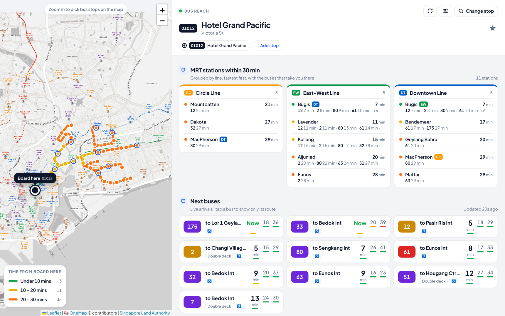

<div align="center">

# 🚌 Singapore Bus Reach

### Bus apps tell you when the bus comes. This one tells you where it gets you.

Pick any bus stop and see the next buses live, plus every stop and MRT station<br>
you can reach in **10, 20 and 30 minutes** on the buses arriving right now.

<br>

[](https://fang89.github.io/Singapore-bus-reach/)

**👉 [fang89.github.io/Singapore-bus-reach/](https://fang89.github.io/Singapore-bus-reach/)**

<br>


<br>

<a href="https://fang89.github.io/Singapore-bus-reach/?stop=01012"><picture><source media="(prefers-color-scheme: dark)" srcset="docs/screenshots/dark.png"></picture></a>

<sub>Hotel Grand Pacific, Victoria St: 11 MRT stations on 3 lines within 30 minutes, without going underground.</sub>

</div>

---

## ✅ What it answers

| | | |
|:-:|---|---|
| ⏱️ | **When is my bus?** | Live arrivals for the next 3 buses of every service, with crowding, double-deck and wheelchair tags. |
| 🗺️ | **Where can I get to in 30 minutes?** | Every reachable stop on the map, coloured by band: under 10, 10–20 and 20–30 minutes from now. |
| 🚇 | **Which MRT stations can I bus to?** | Every station within 30 minutes, grouped by line in the real line colours, fastest first, with the buses that take you there. |
| 🔀 | **Which of my nearby stops is better?** | Add several stops and the times use the fastest bus from any of them. |

## 🧭 How to use it

| | | |
|:-:|---|---|
| 🔍 | **Choose a stop** | Search by name, road or 5-digit code, use **Near me**, or zoom the map in and tap any stop's dot. |
| ➕ | **Add more stops** | **+ Add stop** puts another stop alongside. Tap a stop's chip to leave it out for now, or × to remove it. |
| 🚌 | **See one bus's route** | Tap a bus in *Next buses*, or a column's **Route** button. The map shows only that bus, all the way to the terminus, with the part beyond 30 minutes in grey. |
| 📋 | **Read the stops in order** | *Stops along the way* lists every stop to the terminus with estimated minutes, MRT stops highlighted. Switch to *By travel time* to group them by band. |
| 🎯 | **Filter** | Type a place (Mall, Blk 123, Bedok) or tap **MRT only**. Tap a legend row on the map to hide that band. |
| 🔗 | **Share a stop** | Links remember the stops: [`?stop=01012`](https://fang89.github.io/Singapore-bus-reach/?stop=01012), or several with `?stop=01012,01112`. |
| ⭐ | **Keep favourites** | Star a stop. Favourites and recent stops are stored in your own browser only. |

## ⚙️ Settings

| | | |
|---|---|---|
| **Traffic** | Light, normal or heavy | Cruise speed of 30, 24 or 17 km/h between stops. |
| **Time at each stop** | 15, 25 or 40 s | Added for every stop the bus calls at on the way. |
| **Count the wait** | On by default | Start the clock now, so the wait at the stop is included. Off times the ride only. |
| **Walk to the stop** | 0, 3, 5 or 8 min | Buses that leave before you can get there are skipped. |
| **Lines near home** | Any MRT lines | Listed last in the MRT summary, so new lines stand out. |
| **Theme** | Auto, light, dark | Auto follows your device. |

## 🧮 How the times are worked out

| | | |
|:-:|---|---|
| 📡 | **Arrival at your stop: live** | LTA DataMall bus arrivals, fetched through [arrivelah](https://github.com/cheeaun/arrivelah). Refreshed every 30 s while the tab is open, and again whenever you come back to it. |
| 📐 | **Time to later stops: estimated** | Road distance along the route's real path, at the cruise speed for the traffic setting, plus a dwell time at each stop. LTA publishes no live stop-to-stop times. |
| 🚶 | **The bus you can catch** | The clock starts now and uses the first bus you can still reach after walking to the stop. |

Treat later-stop times as a good guide, not a timetable. Expressway stretches are usually faster than the estimate, and the CBD at peak hour slower.

---

## 🛠️ For contributors

### Repo layout

```
index.html           # the whole app: styles, markup and code in one file
docs/screenshots/    # images used in this README
```

### Run locally

```bash
python3 -m http.server 8000   # then open http://localhost:8000
```

### Deploy (free)

**GitHub Pages**: repo Settings → Pages → "Deploy from a branch" → branch `main`, folder `/` (root).
No build step and no API key. All data is fetched in the browser from services that allow it from any site.

## 📚 Sources & licences

- Live arrivals: [LTA DataMall](https://datamall.lta.gov.sg/) via [arrivelah](https://github.com/cheeaun/arrivelah)
  (contains information from LTA DataMall, [Singapore Open Data Licence](https://data.gov.sg/open-data-licence))
- Stops, services and route shapes: [busrouter.sg](https://busrouter.sg) (`data.busrouter.sg/v1`)
- Map tiles: [OneMap](https://www.onemap.gov.sg/) © Singapore Land Authority
- Map library: [Leaflet](https://leafletjs.com/) 1.9.4. Font: Plus Jakarta Sans.

Independent project: not an LTA, SBS Transit, SMRT, Tower Transit or Go-Ahead product. Line colours follow the network's standard colours.
